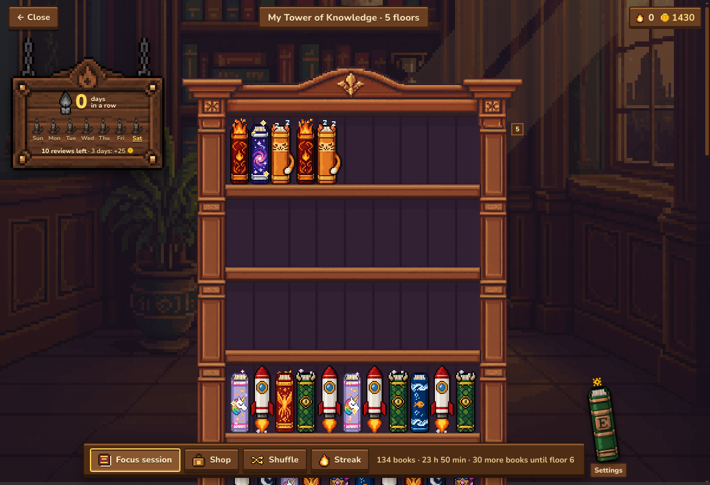
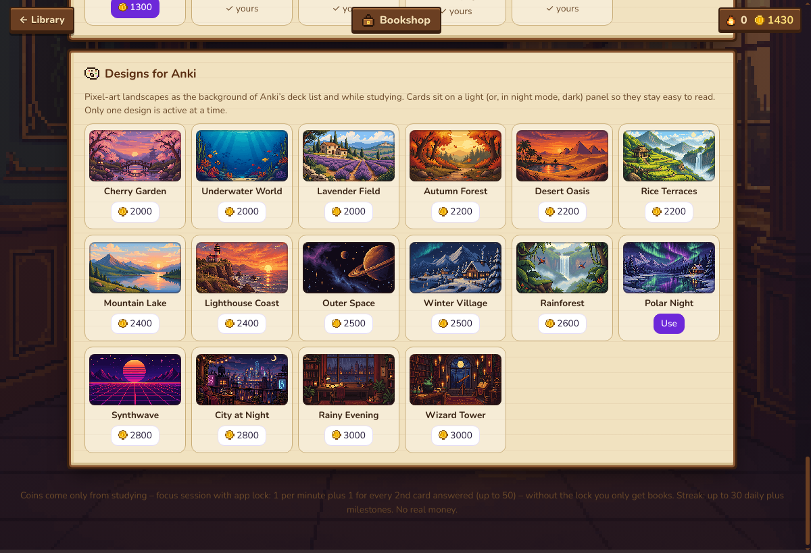
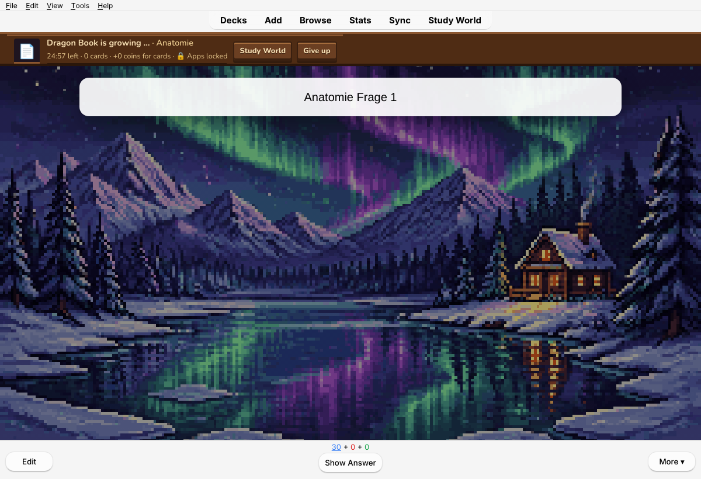

# cozycoder-assets ☕📚

Cozy pixel-art things by **cozycoder**.

## Study World – Focus Timer, App Blocker & Pixel Book Tower (Anki add-on)

Turn your Anki reviews into a growing pixel-art library: start a focus session, study your deck and a new book appears on your shelf every 10 minutes.

- Install from AnkiWeb (Tools → Add-ons → Get Add-ons), or download [`study-world/study-world.ankiaddon`](study-world/study-world.ankiaddon) and double-click it.
- Source code: [`study-world/source`](study-world/source) – licensed under the [GNU AGPL-3.0](study-world/LICENSE).

## Support

If my add-ons make your studying a bit cozier, you can buy me a book ☕

